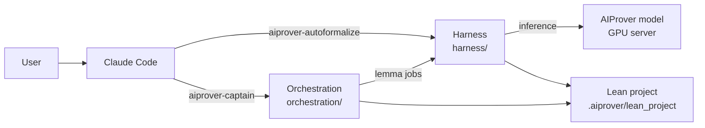

# AIProver

<p align="center">
  <a href="https://arxiv.org/abs/2610.05367"></a>
  <a href="https://jprithwish.github.io/AIProver/"></a>
  <a href="https://huggingface.co/prithwish-jana/aiprover-119b"></a>
</p>

AIProver auto-formalizes a natural-language theorem and its proof into a Lean 4 file that
compiles, contains no `sorry`, states exactly that theorem, and follows that proof. The prover is
a fine-tuned Leanstral-class model driven by an evolved agentic harness (Lean v4.23.0, Mathlib,
cslib, and the lean-lsp tools). The orchestration builds on it: Claude roles formalize a problem,
audit the formalization, decompose the proof into lemmas, and assign each lemma to AIProver jobs.

This repository is the single entry point to that software. It pins each component as a
submodule at a tested commit and sets the components up with Nix. Development takes place inside
each component's own repository, and this repository records which commits work together.

| Component | Path | Repository | Documentation |
| --- | --- | --- | --- |
| Harness | `harness/` | [PrithwishJana/AIProver](https://github.com/PrithwishJana/AIProver) | [HARNESS.md](HARNESS.md) |
| Orchestration | `orchestration/` | [Logan-Cole-Luna/aiprover-orchestration](https://github.com/Logan-Cole-Luna/aiprover-orchestration) | [ORCHESTRATION.md](ORCHESTRATION.md) |
| Claude Code plugins | `skill/` | this repository | [skill/README.md](skill/README.md) |



## Setup

Linux, WSL2, or macOS, with about 15 GB of free disk. Each command builds the environment and
the Lean project, connects the model server, and installs the Claude Code plugins.

```bash
git clone https://github.com/Logan-Cole-Luna/AIProver && cd AIProver
nix run .#setup-harness       -- --endpoint http://<host>:<port>   # the harness alone
nix run .#setup-orchestration -- --endpoint http://<host>:<port>   # the orchestration
nix run .#setup               -- --endpoint http://<host>:<port>   # both
```

On a machine without Nix, `scripts/setup.sh harness|orchestration|all` runs the same steps and
first installs Nix after confirmation (sudo once, to create `/nix`). The setup initializes the
submodules that it needs, so a plain clone suffices.
`--dry-run` prints every step without changing anything, and `--help` lists the options.

| Model server | Options | Connection |
| --- | --- | --- |
| none | `--endpoint none` | no model server; in the orchestration, Claude subagents prove the lemmas |
| reachable from the device | `--endpoint URL [--api-key KEY]` | direct |
| reachable only from an SSH host | `--endpoint URL --via HOST [--user USER]` | SSH tunnel through `HOST` |
| a scheduled job that writes `node=<n> port=<p>` to a file | `--via HOST --handoff FILE` | SSH tunnel to the node that the file names |

`nix develop` (or `direnv allow`, once) opens a shell with the tools of both components, the
`aiprover` CLI on `PATH`, and `AIPROVER_CONFIG` set to the harness configuration of the setup.

## How the orchestration reaches the harness

The orchestration also carries the harness as its own `AIProver/` submodule, so that it remains
usable on its own. Within this repository, the setup runs `orchestration/setup --harness harness/`.
The orchestration then resolves every harness path through the link `orchestration/aiprover/harness`,
which points at this repository's `harness/`, and leaves its own submodule uninitialized.
Consequently, one harness checkout serves both components. The two components also share one
Lean project and the same Nix virtualenvs, so Mathlib is built once and the environments are
built once.

## Versions

| Component | Commit | Date |
| --- | --- | --- |
| harness | `73dc451` | 2026-10-21 |
| orchestration | `<first pin>` | |

`scripts/check-pins.sh` prints this table from the submodule pointers. It fails when the
orchestration's own `AIProver/` pointer differs from `harness/`, since both must name the same
harness commit.

**Releasing a new combination.** Commit and push in the component repository first; when the
harness changes, also bump `AIProver/` in the orchestration. Then, in this repository:

```bash
git -C harness checkout <commit>          # and likewise for orchestration
scripts/check-pins.sh                     # the matrix; must succeed
git add harness orchestration README.md
git commit -m "Bump harness <commit>, orchestration <commit>"
```

**Adding a component** (for example, SAM) takes one submodule, one function and one case in
`scripts/setup.sh`, one app in `flake.nix`, and one row in each table above.

## Layout

```
├── README.md, HARNESS.md, ORCHESTRATION.md
├── flake.nix, flake.lock    # setup apps, harness tools, development shell
├── nix/harness-tools.nix    # programs of the harness and its setup
├── scripts/
│   ├── setup.sh             # the setup commands
│   └── check-pins.sh        # version matrix and consistency check
├── skill/                   # Claude Code marketplace "aiprover" of both plugins
├── harness/                 # submodule: AIProver harness, CLI, and skill
├── orchestration/           # submodule: aiprover-orchestration
└── .aiprover/               # written by the setup: configuration, environments, Lean project, jobs
```
